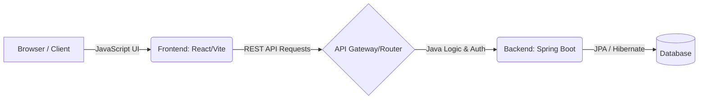

# SkillQuest

> **The PROBLEM: Find a daily frustration. Build the fix. Java is the brain, JavaScript is the face.**

## Introduction

SkillQuest is a comprehensive tracking and learning platform designed to help users structure their journey of acquiring new skills. By breaking down complex skills into manageable modules and actionable tasks, SkillQuest gamifies the learning process. It features a robust backend for secure data management and an interactive, sleek frontend for a seamless user experience. 

## The Problem

**The Daily Frustration:** When trying to learn a new skill (like Photography, Video Editing, or Coding), learners often face information overload. Resources are fragmented, progress is hard to track, and motivation dwindles without a clear roadmap or visible momentum. 

**The Fix:** SkillQuest acts as a personal learning companion. It centralizes skill progression, tracks daily activity (via heatmaps), and provides structured modules and tasks. It transforms the abstract goal of "learning a skill" into a concrete, step-by-step quest.

## Architecture

**Browser → JavaScript → API → Java → Database**



*   **The Face (Frontend):** Built with React, Vite, and modern CSS for a responsive, interactive user dashboard.
*   **The Brain (Backend):** Built with Java and Spring Boot, handling JWT authentication, business logic, and API endpoints.
*   **The Memory (Database):** Structured relational database managed with Flyway migrations.

## How to Run the Project

### Prerequisites
*   Node.js (v16+)
*   Java Development Kit (JDK 17+)
*   Maven
*   Docker (Optional, for database and containerized deployment)

### 1. Using Docker (Recommended for quick setup)
If you have Docker installed, you can spin up the entire environment (database + backend + frontend) using the provided compose file:
```bash
docker-compose up --build
```

### 2. Manual Setup

**Backend (Java/Spring Boot)**
1. Navigate to the backend directory:
   ```bash
   cd backend
   ```
2. Configure your database settings in `src/main/resources/application.properties`.
3. Run the application using Maven:
   ```bash
   ./mvnw spring-boot:run
   ```
*The backend will typically run on `http://localhost:8080`.*

**Frontend (JavaScript/React)**
1. Navigate to the frontend directory:
   ```bash
   cd frontend
   ```
2. Install dependencies:
   ```bash
   npm install
   ```
3. Start the development server:
   ```bash
   npm run dev
   ```
*The frontend will typically run on `http://localhost:5173`.*

## API Endpoints

Here is an overview of the core REST API endpoints powering the application:

### Authentication
*   `POST /api/auth/login` - Authenticate user and receive JWT token.
*   `POST /api/auth/signup` - Register a new user account.

### Skills & Modules
*   `GET /api/skills/search` - Search for available skills to learn.
*   `GET /api/skills/{id}` - Get detailed information about a specific skill.
*   `GET /api/modules/{skillId}` - Retrieve all learning modules for a specific skill.

### User Progress
*   `GET /api/user-skills` - Get a list of skills currently being tracked by the logged-in user.
*   `POST /api/user-skills/start` - Add a new skill to the user's dashboard.
*   `POST /api/tasks/{taskId}/complete` - Mark a specific module task as completed.

### Activity & Analytics
*   `GET /api/activity/heatmap` - Retrieve user activity data to populate the contribution heatmap.
*   `GET /health` - API health check status.

## User Test Notes

*Use this section to document feedback from real users to improve the application iteratively.*

### Tester 1: [Tejasvi]
*   **What they tested:**  Dashboard Heatmap
*   **What they said:** *"I love seeing my daily progress, but the heatmap colors were a bit hard to read on my monitor."*
*   **What was changed:**  Updated the CSS color palette for the heatmap to ensure higher contrast and better accessibility.

### Tester 2: [Name/Role]
*   **What they tested:** Skill Module Navigation
*   **What they said:** *: "Getting back to the main skill list from a specific task felt like it took too many clicks."*
*   **What can be changed:**  Adding a sticky breadcrumb navigation bar at the top of the Skill Modules page for quicker back-tracking.

### Tester 3: [Name/Role]
*   **What they tested:** Task Completion
*   **What they said:** *"I clicked complete on a task, but nothing happened right away, so I clicked it twice."*
*   **What can be changed:**  Implementing an optimistic UI update and a small toast notification to give immediate visual feedback when a task is marked done.

## AI Tools Used

This project was built with the assistance of the following AI tools to accelerate research, learning, and prototyping:

*   **Perplexity:** Used for extensive database design research and schema structuring.
*   **Claude:** Utilized as a learning assistant to understand Spring Boot concepts and establish secure database connectivity.
*   **Gemini:** Used for generating project documentation and creating the basic design prototype/layout concepts.