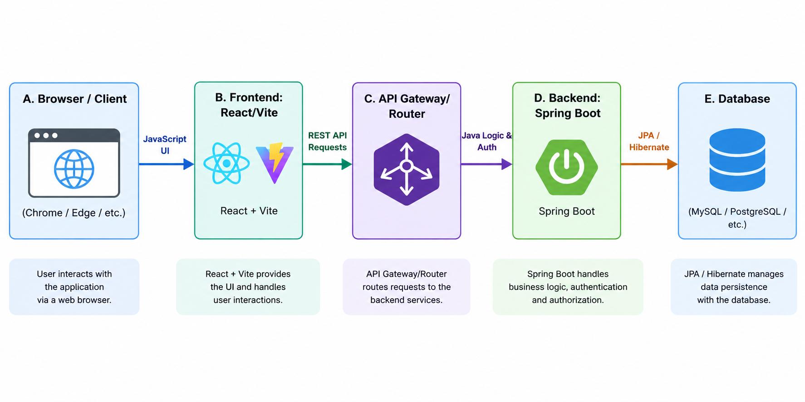
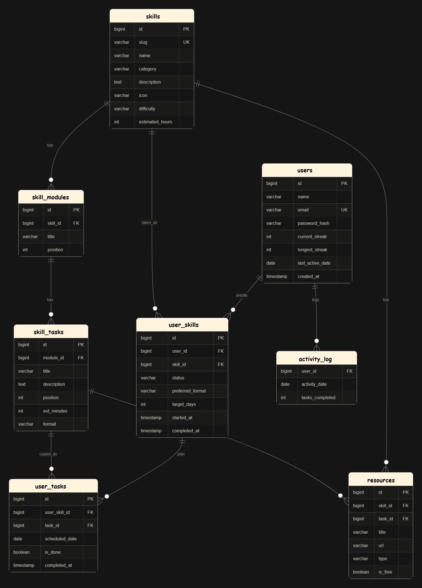

# SkillQuest

## Introduction
SkillQuest is an innovative web platform developed to provide a centralized hub that organizes skill learning routes into one place, offering users carefully curated task lists to guide them through the process of mastering a new skill. 


> **_NOTE:_**  The database is still incomplete as it requires a lot of research time to come up with proper resources and roadmap per skill. We did our best to get as much resource as possible

## Problem it solves
When attempting to learn a new skill (like Photography or Video Editing), beginners often face a massive hurdle: information overload. Tutorials, articles, and courses are scattered all over the internet. The frustration lies in not knowing *where* to start, *what* to learn next, and *how* to track progress. 

SkillQuest fixes this frustration by eliminating the guesswork. It curates a structured, step-by-step learning path (a "quest") for specific skills. Instead of drowning in endless tabs and unorganized bookmarks, users get a clear, actionable checklist of modules and tasks to complete, making the learning journey organized, measurable, and highly rewarding.

## Tech Stack
This project is built using a modern full-stack architecture:

**Frontend:**
*   **React:** UI library for building the interactive dashboard and components.
*   **Vite:** Fast build tool and development server.
*   **CSS:** Custom styles for components (Dashboard, Heatmap, Skill Cards, etc.).

**Backend:**
*   **Java & Spring Boot:** Robust framework handling the REST API, business logic, and user authentication.
*   **Maven:** Dependency management and build automation.
*   **Flyway:** Database migration tool for managing SQL schemas.
*   **JWT (JSON Web Tokens):** For secure user authentication and authorization.

**Infrastructure:**
*   **Docker & Docker Compose:** Containerization for easy deployment and running the database/services locally.

## Project Structure
The repository is divided into two main directories:

```text
SkillQuest/
├── backend/                # Spring Boot REST API
│   ├── src/main/java/...   # Controllers, Models, Repositories, Services, Security
│   ├── src/main/resources/ # Application properties, Flyway DB migrations (.sql)
│   ├── Dockerfile          # Backend containerization
│   └── pom.xml             # Maven dependencies
├── frontend/               # React + Vite Client Application
│   ├── public/             # Static assets (logos, etc.)
│   ├── src/                # React components, pages, styles, context, and api logic
│   ├── package.json        # Node dependencies
│   └── vite.config.js      # Vite configuration
└── docker-compose.yml      # Orchestration for full-stack deployment
```

## Architecture

**Browser → JavaScript → API → Java → Database**



## Database Structure


## How to run / use

### Prerequisites
*   [Node.js](https://nodejs.org/) installed for the frontend.
*   [Java 17+](https://www.oracle.com/java/) and [Maven](https://maven.apache.org/) installed for the backend.
*   [Docker](https://www.docker.com/) (Optional, but recommended for spinning up the full environment quickly).

### Option 1: Running with Docker Compose (Recommended)
You can spin up the entire application (Frontend, Backend, and Database) using Docker Compose from the root directory.
```bash
docker-compose up --build
```

### Option 2: Running Locally (Manual setup)

**1. Start the Backend:**
```bash
cd backend
# If you have a local database set up according to application.properties
./mvnw spring-boot:run
```

**2. Start the Frontend:**
Open a new terminal window/tab.
```bash
cd frontend
npm install
npm run dev
```
The frontend will typically be accessible at `http://localhost:5173`.


## User Test Notes

*Use this section to document feedback from real users to improve the application iteratively.*

### Tester 1
*   **What they tested:**  Dashboard Heatmap
*   **What they said:** *"I love seeing my daily progress, but the heatmap colors were a bit hard to read on my monitor."*
*   **What was changed:**  Updated the CSS color palette for the heatmap to ensure higher contrast and better accessibility.

### Tester 2
*   **What they tested:** Skill Module Navigation
*   **What they said:** *: "Getting back to the main skill list from a specific task felt like it took too many clicks."*
*   **What can be changed:**  Adding a sticky breadcrumb navigation bar at the top of the Skill Modules page for quicker back-tracking.

### Tester 3
*   **What they tested:** Task Completion
*   **What they said:** *"I clicked complete on a task, but nothing happened right away, so I clicked it twice."*
*   **What we changed:**  Implemented a loading feature where the button is disabled until it gets response from backend to prevent repeated calls

## What I learnt
Building SkillQuest during a fast-paced hackathon was an incredible learning experience. Key takeaways include:
*   **Full-Stack Integration:** Successfully connecting a React/Vite frontend with a Java Spring Boot backend, handling CORS, and managing API requests.
*   **Authentication Flow:** Implementing secure user login and registration using JWT (JSON Web Tokens) and protecting private dashboard routes.
*   **Database Migrations:** Using Flyway to version-control the database schema and automatically apply initialization scripts and sample data (like Photography and Premiere Pro skills).
*   **Rapid Prototyping:** Taking an idea from a simple frustration to a fully functional platform with complex UI components like activity heatmaps, progress trackers, and modular skill layouts under a tight deadline.